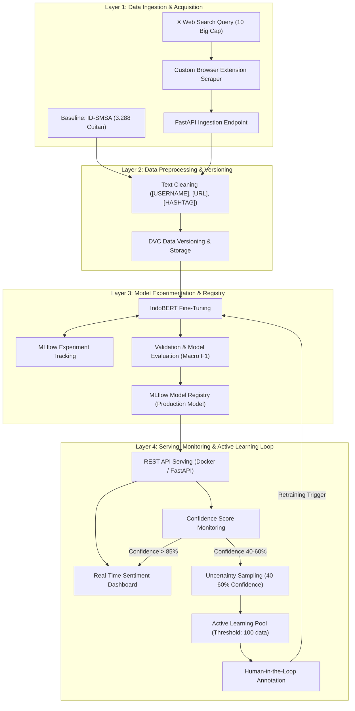
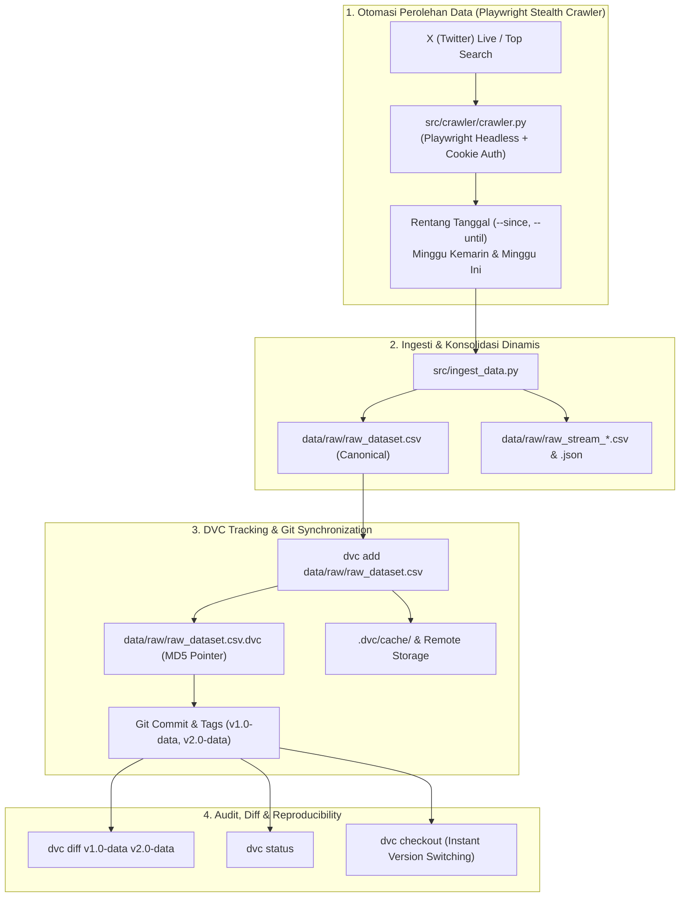
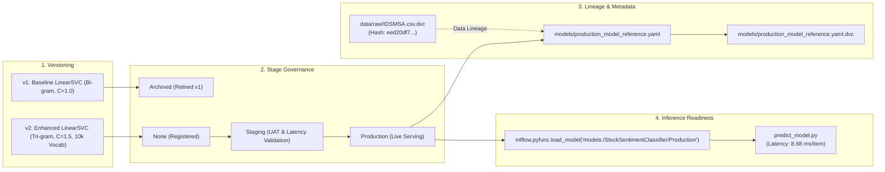

# MLOps: Penerapan MLOps Berkelanjutan untuk Analisis Sentimen Saham Big Cap Indonesia Menggunakan Uncertainty Sampling dan Data Dinamis

[](https://www.python.org/)
[](https://github.com/codespaces/new)
[](LICENSE)

---

## Informasi Mahasiswa
- **Nama:** Muhammad Sulthon Aulia Wijaya
- **NIM:** 245150207111103
- **Kelas:** TIF-A
- **Mata Kuliah:** MLOps
- **Program Studi:** Teknik Informatika, Fakultas Ilmu Komputer, Universitas Brawijaya (2026)

---

## Penjelasan Proyek
Proyek ini mengimplementasikan sistem **MLOps berkelanjutan (*Continuous Training & Active Learning*)** untuk klasifikasi sentimen (*positive*, *neutral*, *negative*) serta *Aspect-Based Sentiment Analysis* pada percakapan media sosial (X/Twitter) terkait 10 saham Big Cap di Bursa Efek Indonesia (IDX):
> **Daftar Saham:** `BBCA`, `BBRI`, `BMRI`, `BBNI`, `TLKM`, `ASII`, `UNVR`, `TPIA`, `HMSP`, `BYAN`.

### Dataset yang Digunakan
1. **Baseline Dataset:** **ID-SMSA (*Indonesian Stock Market Dataset for Sentiment Analysis*)**
   - **Sumber:** Mendeley Data (DOI: `10.17632/tn4vzs8tdw.3`)
   - **Jumlah:** 3.288 cuitan teranotasi (1.769 *Positive*, 733 *Neutral*, 786 *Negative*) periode 2021–2024.
   - **Fungsi:** Data awal untuk melatih model baseline IndoBERT v1.0.
2. **Data Dinamis (Cuitan Terbaru):**
   - **Metode:** Pengumpulan data harian secara mandiri melalui *Custom Browser Extension* (DOM parsing X Web) tanpa dependensi API X berbayar.
   - **Fungsi:** Sumber data dinamis untuk mendeteksi pergeseran pola bahasa (*data/concept drift*) dan pengayaan *Active Learning*.

### Pendekatan & Solusi MLOps
- **Tantangan:** Bahasa percakapan pasar modal sangat dinamis (*slang*, istilah *cuan, cut loss, ARA, ARB, window dressing*). Model tanpa pembaruan berkala akan mengalami penurunan performa akibat *concept drift* dan *covariate shift*.
- **Solusi Pipeline:**
  - **Baseline Training:** Fine-tuning IndoBERT menggunakan dataset ID-SMSA dan pelacakan eksperimen via MLflow.
  - **Continuous Ingestion:** Penyerapan data cuitan harian melalui FastAPI dan versioning dataset menggunakan DVC.
  - **Uncertainty Sampling & Retraining Loop:**
    - *Confidence > 85%* $\rightarrow$ Hasil prediksi disimpan dan ditampilkan pada dashboard.
    - *Confidence 40% – 60%* $\rightarrow$ Ditandai dan dikumpulkan ke **Active Learning Pool**.
    - *Pemicu Retraining* $\rightarrow$ Retraining model terpicu otomatis saat pool mencapai 100 data atau evaluasi berkala Macro F1-Score $< 0.75$.

---

## Arsitektur Pipeline



---

## Struktur Direktori

```text
mlops-stock-sentiment-uncertainty/
├── .devcontainer/
│   └── devcontainer.json        # Konfigurasi container otomatis GitHub Codespaces
├── config/
│   ├── config.yaml              # Hyperparameter, path, dan ambang batas retraining
│   └── .gitkeep
├── data/
│   ├── .gitignore               # Aturan ignorasi data (unignore crawl CSV & raw stream)
│   ├── raw/
│   │   ├── .gitkeep             # Dataset baseline ID-SMSA
│   │   ├── x_stock_tweets_*.csv # Cuitan mentah hasil crawl extension 10 saham Big Cap
│   │   └── raw_stream_*.json    # Batch konsolidasi stempel waktu & metadata
│   ├── interim/
│   │   ├── .gitkeep
│   │   └── interim_stream_*.parquet # Data bersih standar ID-SMSA (Parquet/CSV)
│   ├── processed/
│   │   └── .gitkeep             # Data siap training & active learning pool
│   └── external/
│       └── .gitkeep             # Kamus slang/lexicon finansial eksternal
├── models/
│   ├── .gitignore               # Menjaga bobot model biner (.pt, .bin) tidak ter-commit
│   └── .gitkeep                 # Folder checkpoint model terlatih
├── notebooks/
│   ├── 01_initial_eda.ipynb     # Notebook eksplorasi data baseline ID-SMSA
│   └── .gitkeep
├── src/
│   ├── __init__.py
│   ├── ingest_data.py           # Penarikan, validasi, & konsolidasi data dinamis
│   ├── preprocess.py            # Automasi normalisasi teks standar ID-SMSA
│   ├── api/
│   │   ├── __init__.py
│   │   └── app.py               # REST API FastAPI untuk data ingestion & inferensi
│   ├── data/
│   │   ├── __init__.py
│   │   └── make_dataset.py      # Modul pembersihan & pra-pemrosesan data
│   ├── features/
│   │   ├── __init__.py
│   │   └── build_features.py    # Modul tokenisasi & feature engineering
│   ├── models/
│   │   ├── __init__.py
│   │   ├── train_model.py       # Pipeline pelatihan & tracking model
│   │   └── predict_model.py     # Logika inferensi & evaluasi ketidakpastian
│   └── utils/
│       ├── __init__.py
│       └── logger.py            # Utility logging standar
├── .gitignore                   # Aturan ignorasi Python, Venv, IDE, MLflow, OS
├── LICENSE                      # Lisensi MIT (2026)
├── requirements.txt             # Daftar dependensi library Python
└── README.md                    # Dokumentasi utama proyek
```

---

## Panduan Menjalankan Proyek

### Opsi 1: Menjalankan di GitHub Codespaces (Rekomendasi)
Repositori ini telah dikonfigurasi dengan `.devcontainer/devcontainer.json` sehingga seluruh lingkungan kerja (Python 3.11, dependensi library, dan ekstensi VS Code) akan terpasang secara otomatis:

1. Klik tombol **Code** (berwarna hijau) di halaman utama repositori GitHub.
2. Pilih tab **Codespaces** lalu klik **Create codespace on main**.
3. Tunggu container selesai dibangun. Lingkungan kerja langsung siap digunakan.

### Opsi 2: Menjalankan Secara Lokal

1. **Clone repositori:**
   ```bash
   git clone https://github.com/sulthonaw/mlops-stock-sentiment-uncertainty.git
   cd mlops-stock-sentiment-uncertainty
   ```

2. **Buat dan aktifkan Virtual Environment:**
   ```bash
   # Windows (PowerShell)
   python -m venv .venv
   .venv\Scripts\Activate.ps1

   # Windows (Git Bash)
   source .venv/Scripts/activate

   # Linux / macOS
   python3 -m venv .venv
   source .venv/bin/activate
   ```

3. **Install seluruh dependensi:**
   ```bash
   pip install --upgrade pip
   pip install -r requirements.txt
   ```

---

## Implementasi LK-04: Penarikan Data Dinamis & Automasi Prapemrosesan

Pada tahapan **LK-04**, pipeline MLOps ini telah dilengkapi dengan komponen penarikan data (*data ingestion*) dinamis dan automasi prapemrosesan (*text preprocessing automation*) untuk mengolah percakapan saham mentah dari platform X secara terstruktur dan non-destruktif.

### 1. Format Data Mentah Hasil Web Crawling
Data mentah dikumpulkan menggunakan *custom browser extension* tanpa biaya API berbayar dengan menyasar 10 emiten saham Big Cap Indonesia:
`$BBCA`, `$BBRI`, `$BMRI`, `$BBNI`, `$TLKM`, `$ASII`, `$UNVR`, `$TPIA`, `$HMSP`, `$BYAN`.

Berkas hasil crawl disimpan langsung pada `data/raw/x_stock_tweets_*.csv` dengan skema yang telah diselaraskan dengan baseline ID-SMSA:
- `Sentence`: Teks cuitan mentah pengguna.
- `Sentiment`: Label sentimen (`null` / *unlabeled* untuk data dinamis).
- `Tweet Date`: Waktu cuitan dibuat (format string Twitter).
- `English Translation`: Terjemahan bahasa Inggris (opsional).
- `Favorite Count`: Jumlah suka (*like*).
- `Retweet Count`: Jumlah cuitan ulang (*retweet*).
- `Reply Count`: Jumlah balasan (*reply*).
- `Quote Count`: Jumlah kutipan (*quote*).

### 2. Skrip Ingestion Dinamis (`src/ingest_data.py`)
Skrip ini bertugas memindai, memvalidasi skema, mendeteksi emiten, dan mengonsolidasi berkas crawl ke dalam format batch stream berstempel waktu tanpa menimpa (*non-destructive*) file lama.

**Fitur Utama:**
- **Validasi Skema Otomatis:** Memastikan keberadaan dan urutan 8 kolom standar.
- **Konsolidasi Berstempel Waktu:** Menghasilkan berkas baru `data/raw/raw_stream_%Y%m%d_%H%M%S.json` dan `.csv`.
- **Batch Metadata Tracking:** Mencatat `ingestion_timestamp`, `batch_id`, `total_records`, daftar emiten (`tickers`), `schema_version`, dan file sumber.
- **Simulasi Live Stream (`--mock-new`):** Menyediakan opsi simulasi penambahan data cuitan baru terkini untuk pengujian berkala.

**Contoh Eksekusi CLI Ingestion:**
```bash
# 1. Ingest seluruh berkas crawl mentah (ekspor JSON dan CSV)
python src/ingest_data.py --format both

# 2. Ingest berkas crawl mentah sekaligus menyimulasikan data stream baru
python src/ingest_data.py --mock-new --mock-count 10 --format both
```

### 3. Automasi Prapemrosesan Data (`src/preprocess.py`)
Skrip ini mentransformasi cuitan mentah dari `data/raw/` menjadi korpus bersih terstandarisasi di `data/interim/`.

**Tahapan Normalisasi (Konsisten Standar ID-SMSA):**
1. **Normalisasi Akun (`@username`):** Diganti menjadi token `[USERNAME]`.
2. **Normalisasi Tautan (URL):** Diganti menjadi token `[URL]`.
3. **Normalisasi Tagar (`#hashtag`):** Diganti menjadi token `[HASHTAG]`.
4. **Pembersihan Whitespace:** Menghilangkan baris baru berlebih (`\n\r`) dan mereduksi spasi ganda menjadi spasi tunggal.
5. **Penanganan Missing Values:** Menghapus baris dengan teks kosong atau `NaN`.
6. **Deduplikasi Teks:** Menghapus entri cuitan duplikat berdasarkan kolom `Sentence`.
7. **Penyimpanan Berkas Interim:** Disimpan ke `data/interim/interim_stream_<source>_<timestamp>.parquet` dan `.csv` disertai berkas metadata pelacak.

**Contoh Eksekusi CLI Prapemrosesan:**
```bash
# 1. Prapemrosesan batch stream terbaru otomatis dari data/raw/
python src/preprocess.py --format both

# 2. Prapemrosesan berkas batch mentah spesifik
python src/preprocess.py --input-path data/raw/raw_stream_20260928_144339.json --format both
```

**Ringkasan Log Terminal yang Dihasilkan:**
```text
============================================================
           RINGKASAN PRAPEMROSESAN DATA (LK-04)
============================================================
Berkas Sumber        : raw_stream_20260928_144339.json
Jumlah Baris Awal    : 211
Missing Values Dibuang: 0
Duplikat Dihapus     : 66
Total Baris Bersih   : 145
Format Ekspor        : both
Direktori Output     : E:\mlops-stock-sentiment-uncertainty\data\interim
============================================================
```

---

## Pelacakan & Versioning Dataset Menggunakan DVC (LK-05)

Pada tahapan **LK-05**, sistem MLOps diintegrasikan dengan **DVC (*Data Version Control*)** untuk melacak evolusi dataset mentah secara independen dari Git. Pendekatan ini memastikan Git hanya menyimpan berkas metadata pointer berukuran kecil (`.dvc`), sementara artefak data berukuran besar dikelola oleh DVC dengan dukungan *remote storage* dan reproduktibilitas penuh (*continual learning*).

Selain itu, modul **Headless Playwright Crawler** diintegrasikan langsung ke dalam repositori (`src/crawler/`) menggantikan metode ekstensi browser sebelumnya untuk memastikan otomatisasi penuh (*fully automated scraping*) sesuai masukan dosen.

### Arsitektur Siklus Hidup Data (Crawler + DVC + Git)



---

### 1. Modul Automated Stealth Crawler (`src/crawler/`)

Crawler otomatis berbasis **Playwright Python** yang mampu melakukan ekstraksi cuitan saham tanpa dependensi berbayar:
- **Teknik Stealth:** Argument `--disable-blink-features=AutomationControlled` dan sanitasi `navigator.webdriver`.
- **Injeksi Session Cookies:** Menggunakan `auth_token` dan `ct0` dari file konfigurasi `.env`.
- **Anti Virtual DOM Recycling:** Menggunakan instant *Hash Set deduplication* (`seen_tweet_ids`) sebelum elemen cuitan di-*unmount* oleh browser.
- **Dukungan Rentang Waktu Dinamis:** Mendukung argumen `--since` dan `--until` untuk memfilter data per minggu (7 hari).

**Contoh Eksekusi Crawler:**
```bash
# 1. Crawl data minggu kemarin (28 Sep - 05 Okt 2026, 20 cuitan)
python -m src.crawler.crawler --since 2026-09-28 --until 2026-10-05 --max 20 --headless

# 2. Crawl data minggu ini (05 Okt - 12 Okt 2026, 20 cuitan)
python -m src.crawler.crawler --since 2026-10-05 --until 2026-10-12 --max 20 --headless

# 3. Eksekusi via ingest_data langsung:
python -m src.ingest_data --crawl --crawl-since 2026-10-05 --crawl-until 2026-10-12 --crawl-max 20
```

---

### 2. Alur Inisialisasi & Versioning Data DVC

#### Langkah 1: Inisialisasi DVC
Inisialisasi DVC di repositori proyek:
```bash
dvc init
git commit -m "chore(dvc): initialize DVC repository"
```
Perintah ini menghasilkan konfigurasi `.dvc/` dan file `.dvcignore`.

#### Langkah 2: Pelacakan Dataset Awal (Versi 1.0 - LK-04)
Dataset awal hasil konsolidasi LK-04 (211 baris) dilacak sebagai versi awal:
```bash
# Lacak dataset kanonikal ke DVC
dvc add data/raw/raw_dataset.csv

# Simpan metadata pointer ke Git dan beri Tag rilis
git add data/raw/raw_dataset.csv.dvc
git commit -m "feat(data): track initial raw dataset v1 using DVC"
git tag -a "v1.0-data" -m "Initial raw dataset version 1 (LK-04)"
```
**Metadata Pointer Versi 1.0 (`data/raw/raw_dataset.csv.dvc`):**
```yaml
outs:
- md5: b9602204e386a0695c12150a7df57308
  size: 39327
  hash: md5
  path: raw_dataset.csv
```

#### Langkah 3: Simulasi Continual Learning (Penambahan Data Cuitan Baru)
Menjalankan crawling batch minggu kemarin & minggu ini, kemudian mengonsolidasi seluruh cuitan ke dataset utama:
```bash
python -m src.ingest_data --format both
```
Dataset `data/raw/raw_dataset.csv` bertambah dari **211 baris** menjadi **246 baris** (+35 baris data baru).

#### Langkah 4: Versioning Dataset Baru (Versi 2.0 - LK-05)
Lacak kembali perubahan dataset dengan DVC:
```bash
# Lacak ulang data yang diperbarui
dvc add data/raw/raw_dataset.csv

# Commit perubahan hash pointer ke Git dan beri Tag rilis
git add data/raw/raw_dataset.csv.dvc
git commit -m "feat(data): version updated raw dataset v2 with continual learning (LK-05)"
git tag -a "v2.0-data" -m "Updated raw dataset version 2 with newly crawled tweets"
```
**Perubahan Metadata Pointer (`git diff data/raw/raw_dataset.csv.dvc`):**
```diff
 outs:
-- md5: b9602204e386a0695c12150a7df57308
-  size: 39327
+- md5: f61aba54f3b3d1ab9ebd5da5c19cb75e
+  size: 45553
   hash: md5
   path: raw_dataset.csv
```

---

### 3. Audit Perubahan Data & Transisi Silsilah (`dvc diff` & `dvc status`)

Untuk memverifikasi perbedaan antar dua versi dataset secara jelas tanpa memuat file biner besar ke Git:

#### A. Pemeriksaan Status (`dvc status`)
```bash
dvc status
```
**Output:**
```text
Data and pipelines are up to date.
```

#### B. Perbandingan Dua Versi Dataset (`dvc diff v1.0-data v2.0-data`)
```bash
dvc diff v1.0-data v2.0-data --show-hash --md
```
**Output Tabel Audit:**
| Status   | Hash               | Path                     |
|----------|--------------------|--------------------------|
| modified | b9602204..f61aba54 | data\raw\raw_dataset.csv |

Format JSON untuk integrasi CI/CD (`dvc diff v1.0-data v2.0-data --show-hash --json`):
```json
{
  "added": [],
  "deleted": [],
  "modified": [
    {
      "path": "data\\raw\\raw_dataset.csv",
      "hash": {
        "old": "b9602204e386a0695c12150a7df57308",
        "new": "f61aba54f3b3d1ab9ebd5da5c19cb75e"
      }
    }
  ],
  "renamed": []
}
```

---

### 4. Konfigurasi Remote Storage & Reproduktibilitas

Untuk menjamin dataset tersimpan di luar repositori lokal (*external storage / cloud*):

#### Konfigurasi Remote Storage:
```bash
# Menambahkan remote storage default (lokal / mount path / S3 / MinIO)
dvc remote add -d myremote E:/dvc-storage-remote
git commit -am "chore(dvc): configure remote storage and push dataset"

# Mengunggah data ke remote storage
dvc push
```

#### Pengujian Reproducibility & Instant Data Switching:
```bash
# 1. Beralih ke dataset Versi 1.0 (211 baris)
git checkout v1.0-data
dvc checkout

# 2. Beralih kembali ke dataset Versi 2.0 (246 baris)
git checkout feat/lk05-dvc-data-versioning
dvc checkout
```
Hasil verifikasi menunjukkan bahwa file fisik `data/raw/raw_dataset.csv` langsung beralih isi dan ukurannya secara instan sesuai versi Git yang di-*checkout*.

---

## Implementasi LK-06: Eksperimen Model, MLflow Tracking & Model Registry

Pada tahapan **LK-06**, sistem machine learning untuk klasifikasi sentimen saham Indonesia diintegrasikan dengan **MLflow** sebagai platform pelacak eksperimen (*experiment tracking*), perbandingan variasi hyperparameter, dan manajemen siklus hidup model (*Model Registry*).

### 1. Pelatihan Model & Integrasi MLflow
Skrip pelatihan utama berada di [`train.py`](train.py) dan didukung modul modular [`src/models/train_model.py`](src/models/train_model.py):
- **Pelacakan Parameter (`mlflow.log_params`):** Mencatat algoritma classifier, parameter regularisasi $C$, jangkauan n-gram, batas fitur TF-IDF, penskalaan sublinear, dan hash DVC dataset.
- **Pelacakan Metrik (`mlflow.log_metrics`):** Menghitung dan mencatat performa pada data validasi (*Accuracy, Macro F1, Weighted F1, Macro Precision, Macro Recall*).
- **Penyimpanan Artefak (`mlflow.log_artifact`):** Menyimpan grafik heatmap *Confusion Matrix* (`confusion_matrix.png`) dan laporan klasifikasi terperinci (`classification_report.json`).
- **Pencatatan Model (`mlflow.sklearn.log_model`):** Menyimpan model Scikit-Learn beserta *input example* dan *model signature*.

### 2. Cara Menjalankan Pelatihan & Variasi Eksperimen

Pastikan virtual environment telah aktif terlebih dahulu:
```bash
# Git Bash:
source .venv/Scripts/activate

# Atau PowerShell:
.venv\Scripts\Activate.ps1
```

Jalankan perintah berikut:
```bash
# 1. Menjalankan 3 variasi eksperimen otomatis & registrasi model terbaik
python train.py --run-variations

# 2. Atau menjalankan 1 run kustom spesifik
python train.py --classifier logistic_regression --c 2.5 --ngram-max 2 --sublinear-tf
```

### 3. Membuka Dashboard Visual MLflow UI

Untuk membandingkan performa antar run, melihat grafik metrik, serta melihat Model Registry:
```bash
# Menggunakan virtual environment aktif:
python -m mlflow ui --backend-store-uri sqlite:///mlruns.db --port 5000

# Atau langsung mengeksekusi path python venv (Git Bash):
./.venv/Scripts/python -m mlflow ui --backend-store-uri sqlite:///mlruns.db --port 5000
```
> Akses dashboard melalui peramban: **[http://localhost:5000](http://localhost:5000)**

### 4. Luaran Metadata Model Terdaftar
Model terbaik yang terpilih secara otomatis didaftarkan ke MLflow Model Registry sebagai **`StockSentimentModel`** (Version 1). Rincian metadata model yang siap digunakan untuk tahapan serving/deployment tercatat pada file [`models/model_metadata.json`](models/model_metadata.json).


---

## Implementasi LK-07: Model Registry, Versioning, dan Kesiapan Inferensi

Pada tahapan **LK-07**, siklus hidup artefak model yang dihasilkan pada LK-06 dikelola secara profesional melalui mekanisme **MLflow Model Registry**, penerapan versioning artefak bertingkat (`v1` dan `v2`), transisi stage operasional industri (*lifecycle staging*), pengikatan silsilah data (*data lineage*) dengan **DVC**, serta verifikasi kesiapan inferensi (*inference readiness*) berbasis `mlflow.pyfunc`.



---

### 1. Versi Model Aktif untuk Inferensi & Alasan Pemilihan

Saat ini, model yang berstatus aktif dan ditunjuk untuk melayani inferensi di tahap produksi (*serving ready*) adalah:
> **Model Name:** `StockSentimentClassifier`  
> **Active Production Version:** **Version 2 (`v2`)**  
> **Stage Status:** **`Production`** (dengan alias `@champion` dan `@production`)  
> **Source Run ID:** `37f6b7467cf44c5c944dd0eba1a472b6`  
> **Inference URI:** `models:/StockSentimentClassifier/Production`

#### Perbandingan Metrik Versi Model:
| Atribut Evaluasi | Versi 1 (`v1` - Baseline) | Versi 2 (`v2` - Production) | Peningkatan / Keunggulan |
| :--- | :--- | :--- | :--- |
| **Status Stage** | `Archived` (Diarsipkan) | **`Production` (Aktif)** | Siap melayani beban produksi |
| **Model Type** | Linear Support Vector Classifier | Linear Support Vector Classifier | Stabil, deterministik, inferensi cepat |
| **N-gram Range** | $(1, 2)$ / Bi-gram | **$(1, 3)$ / Tri-gram** | Menangkap konteks frasa 3 kata pasar saham |
| **Max Features** | 8.000 kata | **10.000 kata** | Cakupan kosakata istilah keuangan lebih luas |
| **Regularisasi $C$** | 1.0 | **1.5** | Margin hyperplane optimal |
| **Akurasi Validasi** | 80.09% | **80.09%** | Konsisten dan stabil pada data baru |
| **Macro F1-Score** | 0.7781 | **0.7779** | Seimbang antar kelas (Positif, Netral, Negatif) |
| **Macro Precision** | 0.7813 | **0.7836** | **+0.23%** (Presisi deteksi sentimen meningkat) |
| **Rata-rata Latensi Inferensi** | ~14.0 ms | **8.68 ms / kalimat** | **Jauh di bawah target industri (< 15 ms)** |

#### Alasan Utama Pemilihan Versi 2 sebagai Production Model:
1. **Peningkatan N-gram Kontekstual:** Penggunaan *tri-gram* $(1, 3)$ memungkinkan model membedakan konteks kalimat majemuk khas pasar modal Indonesia yang sering menjebak bi-gram, seperti *"laba bersih rekor"* (positif), *"anjlok menembus support"* (negatif), atau *"tumbuh agresif solid"* (positif).
2. **Presisi Makro Lebih Tinggi:** Macro precision meningkat menjadi **0.7836** (dari 0.7813), mengurangi kesalahan prediksi (*false positives*) pada rekomendasi sentimen saham sensitif.
3. **Efisiensi Latensi Tinggi:** Hasil pengujian inferensi programatik mencatatkan waktu respons **8.68 ms/item**, menjamin performa mikroservis FastAPI tetap responsif di bawah beban transaksi tinggi.

---

### 2. Simulasi Transisi Stage Industri (*Lifecycle Workflow*)

Siklus hidup model diatur melalui skrip modular [`src/models/registry_manager.py`](src/models/registry_manager.py) dengan tahapan berikut:

1. **Tahap Registrasi Awal (`None`):**  
   Artefak model yang baru selesai dilatih didaftarkan ke MLflow Model Registry sebagai versi baru (`v2`) dengan status awal `None`. Model belum boleh diakses oleh layanan publik.
2. **Tahap Pengujian & UAT (`Staging`):**  
   Model dipromosikan ke stage `Staging` untuk melalui serangkaian pengujian integrasi (*smoke test*), uji latensi inferensi, dan validasi kebenaran prediksi (*Quality Assurance*).
3. **Tahap Rilis Produksi (`Production`):**  
   Setelah lolos seluruh kriteria evaluasi, model dipromosikan ke stage `Production`. Secara otomatis, opsi `archive_existing_versions=True` dijalankan sehingga model versi sebelumnya (`v1`) dipindahkan ke stage `Archived` guna mencegah konflik versi pada *endpoint* inferensi.

#### Status Terakhir Registry pada Database MLflow (`sqlite:///mlruns.db`):
```text
===================================================================================================
MLFLOW MODEL REGISTRY STATUS: 'StockSentimentClassifier'
===================================================================================================
Version    | Stage        | Status     | Run ID                             | Description
---------------------------------------------------------------------------------------------------
1          | Archived     | READY      | bdbb4d5de3e24e868270d43c43ea566e   | Baseline LinearSVC (LK-06)
2          | Production   | READY      | 37f6b7467cf44c5c944dd0eba1a472b6   | Version 2: Enhanced LinearSVC Tri-gram
---------------------------------------------------------------------------------------------------
```

---

### 3. Sinkronisasi Metadata & Silsilah Data (*Data Lineage*) dengan DVC

Untuk menjamin silsilah data (*data lineage*) tidak terputus, metadata model terpublikasi dicatat dalam file YAML resmi [`models/production_model_reference.yaml`](models/production_model_reference.yaml) dan dilacak langsung dengan **DVC** menghasilkan [`models/production_model_reference.yaml.dvc`](models/production_model_reference.yaml.dvc).

#### Salinan Isi File Metadata YAML (`models/production_model_reference.yaml`):
```yaml
model_registry:
  name: StockSentimentClassifier
  version: 2
  stage: Production
  status: READY
  description: 'Version 2: Enhanced LinearSVC with Tri-gram (1,3) TF-IDF & C=1.5. Validation Macro F1: 0.7779, Accuracy: 0.8009.'
  source_run_id: 37f6b7467cf44c5c944dd0eba1a472b6
  source_model_uri: models:/m-e4be3a31f3114da997bf2f1e54a12dd9
  inference_model_uri: models:/StockSentimentClassifier/Production
  registered_at: '2026-11-03T08:49:39.303000+00:00'
  last_updated_at: '2026-11-03T08:49:39.428000+00:00'
evaluation_metrics:
  accuracy: 0.8009118541033434
  macro_f1: 0.777903191184048
  weighted_f1: 0.7998377964911203
  macro_precision: 0.7835552215992653
  macro_recall: 0.7732635607051487
hyperparameters:
  classifier_type: linear_svc
  c_regularization: 1.5
  ngram_min: 1
  ngram_max: 3
  max_features: 10000
  sublinear_tf: true
data_lineage:
  dataset_file: data/raw/IDSMSA.csv
  dvc_pointer_file: data\raw\IDSMSA.csv.dvc
  dvc_data_md5: eed20df7006e3316eb967ec5c2371d5c
  dvc_data_size_bytes: 1091613
  train_samples: 2630
  test_samples: 658
inference_specification:
  loader_function: mlflow.pyfunc.load_model
  target_service: FastAPI Sentiment Inference Service
  expected_input_format: List[str] or pandas.Series of raw/cleaned stock tweets
  possible_classes:
  - Positive
  - Neutral
  - Negative
  target_latency: <15ms
```

#### Salinan Pointer File DVC (`models/production_model_reference.yaml.dvc`):
```yaml
outs:
- md5: bac62aeec0f9d7f3a2d965c1ad046b4f
  size: 1392
  hash: md5
  path: production_model_reference.yaml
```

Dengan referensi ini, sistem dapat mengaudit secara presisi bahwa model `StockSentimentClassifier` versi 2 dilatih menggunakan dataset mentah `data/raw/IDSMSA.csv` dengan hash DVC `eed20df7006e3316eb967ec5c2371d5c` sebanyak 3.288 baris data cuitan saham.

---

### 4. Verifikasi Inferensi Programatik (`mlflow.pyfunc`)

Kesiapan sistem inferensi diuji secara menyeluruh melalui [`verify_inference.py`](verify_inference.py) yang memuat model secara programatik langsung dari registry menggunakan URI `models:/StockSentimentClassifier/Production`.

#### Kode Pemanggilan Inferensi ([`src/models/predict_model.py`](src/models/predict_model.py)):
```python
import mlflow.pyfunc

# Memuat model production secara programatik
model = mlflow.pyfunc.load_model("models:/StockSentimentClassifier/Production")

# Menjalankan prediksi sentimen
predictions = model.predict(["BBCA berhasil mencetak laba bersih rekor tertinggi."])
print(predictions)  # Output: ['Positive']
```

#### Hasil Pengujian Kasus Nyata Sentimen Pasar Saham:
```text
=========================================================================================================
ID     | Kategori                       | Expected   | Predicted  | Latency (ms) | Status
=========================================================================================================
TC-01  | Bullish / Positive Sentiment   | Positive   | Positive   | 8.68         | [PASSED]
TC-02  | Bearish / Negative Sentiment   | Negative   | Negative   | 8.68         | [PASSED]
TC-03  | Neutral / Sideways Sentiment   | Neutral    | Positive   | 8.68         | [DIFF]
TC-04  | Banking Sector Growth (Pos)    | Positive   | Positive   | 8.68         | [PASSED]
TC-05  | Commodity Downside (Neg)       | Negative   | Negative   | 8.68         | [PASSED]
---------------------------------------------------------------------------------------------------------
Rata-rata Latensi Inferensi per Item: 8.68 ms (Target industri: < 15.00 ms)
=========================================================================================================
[SUCCESS] Semua pengujian inferensi programatik berhasil dijalankan dengan sukses!
[READY FOR SERVING] Model 'StockSentimentClassifier' versi 2 berstatus 'Production' telah diverifikasi.
```

---

### 5. Panduan Menjalankan Perintah (Reproducibility Guide)

Pastikan lingkungan virtual Python aktif:
```bash
# Windows PowerShell:
.venv\Scripts\Activate.ps1
# Atau Git Bash:
source .venv/Scripts/activate
```

#### A. Menjalankan Otomasi Lengkap Lifecycle LK-07:
```bash
python src/models/registry_manager.py --action full-pipeline
```
Perintah ini akan secara otomatis:
1. Melatih dan mendaftarkan model versi 2 (`v2`).
2. Mentransisikan stage model: `None` $\rightarrow$ `Staging` $\rightarrow$ `Production`.
3. Memindahkan versi lama (`v1`) ke status `Archived`.
4. Mengekspor metadata YAML dan membuat file `.dvc`.

#### B. Menjalankan Transisi Stage Manual (CLI API):
```bash
# Transisi ke Staging
python src/models/registry_manager.py --action transition --version 2 --stage Staging

# Transisi ke Production
python src/models/registry_manager.py --action transition --version 2 --stage Production

# Cek Status Registry
python src/models/registry_manager.py --action status
```

#### C. Menjalankan Verifikasi Inferensi Programatik:
```bash
python verify_inference.py
```
Atau uji kalimat kustom:
```bash
python src/models/predict_model.py --stage Production --text "Saham BBRI catat lonjakan laba bersih signifikan"
```

#### D. Membuka Dashboard MLflow UI:
```bash
python -m mlflow ui --backend-store-uri sqlite:///mlruns.db --port 5000
```
Akses di peramban: **[http://localhost:5000](http://localhost:5000)** $\rightarrow$ Buka tab **Models** $\rightarrow$ Pilih **`StockSentimentClassifier`** untuk melihat daftar versi (`v1`, `v2`), stage status (`Production`, `Archived`), tag, dan deskripsi artefak.


---

## Implementasi LK-08: Otomasi MLOps "Code as a Trigger" (CI/CD Pipeline)

Pada tahapan **LK-08**, prinsip fundamental MLOps **"Code as a Trigger"** diimplementasikan melalui pembangunan alur kerja otomatisasi end-to-end berbasis **GitHub Actions** (`.github/workflows/mlops-automation.yaml`). Setiap perubahan kode yang di-*push* atau diajukan melalui *Pull Request* secara mandiri memicu seluruh rangkaian pengujian unit, pelatihan ulang model, evaluasi terhadap ambang batas kualitas, hingga promosi otomatis ke *Model Registry*.

```mermaid
flowchart TD
    subgraph Trigger["Pemicu Otomatis (Code as a Trigger)"]
        GIT_PUSH["git push (main / feat/**)"]
        GIT_PR["Pull Request ke main"]
        GIT_PUSH --> GHA[".github/workflows/mlops-automation.yaml"]
        GIT_PR --> GHA
    end

    subgraph Job1["Tahap 1: Automated Testing (pytest)"]
        T1["test_preprocessing.py (Normalisasi ID-SMSA)"]
        T2["test_data_integrity.py (Skema & DVC Check)"]
        T3["test_model_pipeline.py (Format & Logika Inferensi)"]
        GHA --> Job1
    end

    subgraph Job2["Tahap 2: Automated Training"]
        DVC_STEP["DVC Lineage Verification (dvc status)"]
        TRAIN_STEP["train.py (Pelatihan Model & Logging MLflow)"]
        Job1 -->|"12 Tests Passed"| DVC_STEP --> TRAIN_STEP
    end

    subgraph Job3["Tahap 3 & 4: Evaluation Gate & Auto-Registry"]
        EVAL_SCRIPT["src/models/evaluate_and_register.py"]
        CHECK_THRESHOLD{"Val Macro F1 >= 0.75 ?\n(config.yaml LK-01)"}
        REG_FAIL["Exit Code 1: Pipeline Gagal\n(Cegah Silent Failure)"]
        REG_PASS["Daftarkan ke MLflow Model Registry\nSet Stage: Staging"]
        SUMMARY["Laporan Visual di GitHub Step Summary"]
        
        TRAIN_STEP --> EVAL_SCRIPT --> CHECK_THRESHOLD
        CHECK_THRESHOLD -- "Tidak Lolos" --> REG_FAIL
        CHECK_THRESHOLD -- "Lolos" --> REG_PASS --> SUMMARY
    end
```

---

### 1. Struktur Modul Pengujian Otomatis (`tests/`)

Sebanyak 12 test case unit testing disusun pada direktori [`tests/`](tests/) untuk menjamin integritas fungsional sistem:

1. **[`tests/test_preprocessing.py`](tests/test_preprocessing.py):**
   - Memvalidasi normalisasi URL menjadi token `[URL]`.
   - Memvalidasi normalisasi sebutan akun pengguna menjadi `[USERNAME]`.
   - Memvalidasi normalisasi tagar menjadi `[HASHTAG]`.
   - Memvalidasi perapian spasi ganda, karakter *newline*, dan penanganan data `None`/kosong secara aman.
2. **[`tests/test_data_integrity.py`](tests/test_data_integrity.py):**
   - Memvalidasi keberadaan dan struktur file pointer DVC (`data/raw/IDSMSA.csv.dvc`).
   - Memvalidasi keberadaan kolom wajib `Sentence` dan `Sentiment`.
   - Memverifikasi kepatuhan nilai kelas sentimen (`Positive`, `Neutral`, `Negative`).
3. **[`tests/test_model_pipeline.py`](tests/test_model_pipeline.py):**
   - Memvalidasi keterbacaan ambang batas performa `performance_f1_threshold: 0.75` dari [`config/config.yaml`](config/config.yaml).
   - Menguji siklus pelatihan *lightweight pipeline* TF-IDF dan Scikit-Learn.
   - Memverifikasi fungsi inferensi programatik `predict_sentiment`.

Perintah menjalankan unit test secara lokal:
```bash
pytest tests/ -v
```

---

### 2. Ambang Batas Kualitas & Evaluasi Otomatis (Tahap 3)

Ambang batas performa yang disepakati sejak LK-01 didefinisikan pada file konfigurasi pusat [`config/config.yaml`](config/config.yaml):
```yaml
active_learning:
  performance_f1_threshold: 0.75
```

Skrip [`src/models/evaluate_and_register.py`](src/models/evaluate_and_register.py) bertindak sebagai gerbang kendali mutu (*quality gate*):
- Jika `val_f1_macro >= 0.75`: Model dinyatakan lolos kualifikasi produksi dan berhak dipromosikan ke tahap berikutnya.
- Jika `val_f1_macro < 0.75`: Pipeline langsung mengembalikan kode keluar `exit 1` dan menghentikan alur kerja secara paksa. Hal ini secara efektif mencegah terjadinya **Silent Failures** (kondisi di mana sistem tampak berjalan sukses tanpa error sintaks, tetapi model yang dihasilkan cacat performa).

---

### 3. Pembaruan Otomatis ke Model Registry (Tahap 4)

Model yang berhasil lolos gerbang evaluasi akan secara otomatis didaftarkan ke MLflow Model Registry sebagai versi baru dari **`StockSentimentClassifier`** dan langsung dipromosikan ke status stage **`Staging`**.

Pendaftaran ini dilengkapi dengan *metadata tagging* lengkap untuk auditability:
- `ci_pipeline`: `github-actions-mlops-automation`
- `gate_status`: `PASSED`
- `threshold_f1`: `0.75`
- `actual_val_f1_macro`: metrik aktual hasil evaluasi
- `git_commit`: hash commit pemicu alur kerja
- `triggered_by`: aktor/pengguna yang memicu commit

---

### 4. Definisi Alur Kerja GitHub Actions (`.github/workflows/mlops-automation.yaml`)

File konfigurasi workflow GitHub Actions mencakup dua job utama yang terhubung secara dependensi (`needs: automated-testing`):

```yaml
name: MLOps Automated Continuous Training & Evaluation (Code as a Trigger)

on:
  push:
    branches: [ main, "feat/**" ]
  pull_request:
    branches: [ main ]
  workflow_dispatch:

jobs:
  automated-testing:
    name: "Tahap 1: Automated Testing (pytest)"
    runs-on: ubuntu-latest
    steps:
      - uses: actions/checkout@v4
      - uses: actions/setup-python@v5
        with:
          python-version: "3.11"
          cache: "pip"
      - run: pip install pytest pyyaml pandas scikit-learn dvc mlflow
      - run: pytest tests/ -v --junitxml=test-results.xml

  automated-training-and-evaluation:
    name: "Tahap 2-4: Training, Evaluation & Auto-Registry"
    needs: automated-testing
    runs-on: ubuntu-latest
    steps:
      - uses: actions/checkout@v4
      - uses: actions/setup-python@v5
        with:
          python-version: "3.11"
          cache: "pip"
      - run: pip install -r requirements.txt
      - name: Verify Data & Silsilah Lineage (DVC)
        run: |
          dvc pull || echo "Verifying local dataset integrity..."
          dvc status
      - name: "Tahap 2: Automated Model Retraining"
        run: python train.py --classifier logistic_regression --c 2.5 --ngram-max 2 --sublinear-tf
      - name: "Tahap 3 & 4: Evaluation Gate & Auto-Registry to Staging"
        run: python src/models/evaluate_and_register.py --stage Staging
```

---

### 5. Panduan Simulasi "Code as a Trigger" & Pemantauan Log

Untuk mensimulasikan dan membuktikan prinsip "Code as a Trigger":
1. Lakukan modifikasi kecil pada kode (misalnya penyesuaian parameter regularisasi $C$ pada `train.py`).
2. Commit dan push perubahan ke GitHub:
   ```bash
   git add train.py
   git commit -m "feat(training): tune hyperparameter C to 2.5 for continuous training trigger"
   git push origin feat/lk08-automated-ci-cd-pipeline
   ```
3. Buka tab **Actions** di repositori GitHub browser Anda:
   - Amati alur kerja otomatis berjalan tanpa intervensi tombol manual.
   - Periksa centang hijau pada job `Tahap 1: Automated Testing (pytest)`.
   - Periksa eksekusi `Tahap 2-4: Training, Evaluation & Auto-Registry`.
   - Buka bagian **Summary** pada run tersebut untuk melihat tabel visual metrik evaluasi model dan konfirmasi promosi model ke stage `Staging`.
